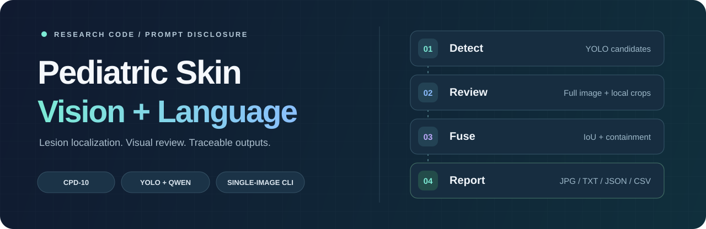

<a id="top"></a>

<div align="center">



# 儿童皮肤病图像分析 · YOLO × Qwen

**单图病灶检测 · 闭集视觉复核 · 可追溯融合 · 提示词披露**

<p>
  
  
  
  
  
</p>

<p>
  <a href="sn-article.pdf"><strong>📄 论文全文</strong></a> ·
  <a href="#quickstart">🚀 快速开始</a> ·
  <a href="#results">📊 实验结果</a> ·
  <a href="#prompts">📝 提示词披露</a> ·
  <a href="#acknowledgements">🤝 致谢与链接</a>
</p>

**An Interpretable Vision-Language Framework Integrating Visual and Morphological Features for TCM-Assisted Assessment of Pediatric Allergic Skin Diseases**

</div>

---

<a id="overview"></a>

## 🔎 项目概览

本目录提供上述论文相关的**单图推理、结果展示与提示词披露材料**。程序先使用 YOLO 定位候选病灶，再由 Qwen 分别检查整图与局部裁剪区域，通过空间匹配和规则融合生成检测记录，并导出「原图 / YOLO 检测图 / 英文辅助结果」三栏报告。

| 🎯 病灶检测 | 🔍 双层视觉复核 | 📋 结果追溯 |
| :--- | :--- | :--- |
| YOLO 初始定位与类别预测 | 整图上下文与局部裁剪复判 | 原始、去重与融合记录分别保存 |
| IoU 与包含关系二次去重 | 在 `data.yaml` 指定类别内判断 | JPG、TXT、JSON、CSV 多格式导出 |
| 保留候选框与原始置信度 | 记录视觉描述、图像质量与不确定性 | 保存融合动作、原因与 API 缓存 |

> [!NOTE]
> **代码覆盖范围：** 当前目录包含推理与披露工具；论文描述的检测网络训练、热图形态特征提取和完整评估流程需要额外代码与实验材料。数据集、模型权重及自定义 Ultralytics 源码需另行准备。

<a id="dataset"></a>

## 🗂️ 数据集与类别

论文使用 **CPD-10** 儿童皮肤病图像数据集。按随附论文 §3.1 的设置，共 **1,453 张图像、10 个类别**，划分为 **1,163 张训练图像**与 **290 张测试图像**。

**获取数据：** [CPD-10 数据集目录](https://github.com/ACMISLab/fdd_2020/tree/main/CPD-10) · [数据集对应论文 DKFD](https://doi.org/10.3390/app13105958)

<details>
<summary><strong>展开查看历史类别映射与图像数量</strong></summary>

类别 ID 与英文名称来自 [`original_prompt_templates_zh.json`](original_prompt_templates_zh.json)，数量来自随附论文 Table 1。

| ID | 历史类别名称 | 图像数 |
| ---: | :--- | ---: |
| 0 | Hand-Food-And-Mouth Disease | 164 |
| 1 | Atopic dermatitis | 343 |
| 2 | folliculitis | 159 |
| 3 | Chickenpox | 171 |
| 4 | Urticaria | 138 |
| 5 | insect bite | 104 |
| 6 | pyogenic paronychia | 112 |
| 7 | Impetigo | 117 |
| 8 | Diaper dermatitis | 36 |
| 9 | furuncle | 109 |
| | **合计** | **1,453** |

`Hand-Food-And-Mouth Disease` 保留历史记录中的原始拼写。实际推理从 `data.yaml` 的 `names` 读取类别；类别 ID、顺序和名称应与所用权重保持一致。上述数量描述数据集分布，不构成可恢复历史划分的图像清单。

</details>

<a id="quickstart"></a>

## 🚀 快速开始

在本目录执行命令；将 `/path/to/...` 替换为实际路径。两个 Python 文件需放在同一目录。

### 1. 准备环境

论文实验使用 Python 3.10。以下为基础安装示例；本目录未提供依赖版本锁定文件。

```bash
python3.10 -m venv .venv
source .venv/bin/activate
python -m pip install --upgrade pip

# 离线生成三栏报告所需的直接依赖
python -m pip install opencv-python pillow

# 新推理还需这些依赖，以及与权重匹配的 Ultralytics 实现
python -m pip install numpy pyyaml pandas openai torch torchvision
```

使用与训练时一致的 PyTorch/CUDA 和自定义检测网络环境。若已有包含 `ultralytics/` 包的完整源码目录，可按该项目的安装说明配置，并在推理时使用 `--yolo-root` 指定路径。自定义权重所需模块可能不包含在标准 `ultralytics` 安装包中。

### 2. 运行单图检测与融合

准备输入图像、YOLO 权重、含 `names` 字段的数据集 YAML，以及可调用对应模型的 DashScope API key：

```bash
python single_image_three_panel_report.py \
  --image /path/to/image.jpg \
  --weights /path/to/best.pt \
  --data /path/to/data.yaml \
  --yolo-root /path/to/ultralytics-skin \
  --out ./runs/image_demo \
  --api-key-stdin
```

终端提示后输入 API key，交互输入不会回显。也可提前设置 `DASHSCOPE_API_KEY` 环境变量，并省略 `--api-key-stdin`。若正确的 Ultralytics 实现已安装到当前环境，可省略 `--yolo-root`；程序也会从脚本的上级目录自动查找本地实现。

代码默认模型为 `qwen3.6-plus`，请求地址为 `https://dashscope.aliyuncs.com/compatible-mode/v1`；可通过 `--qwen-model` 和 `--base-url` 调整。在线推理会向该服务发送整图和候选区域裁剪图。

## 💡 常见问题

<details>
<summary><strong>加载权重时提示找不到自定义模块怎么办？</strong></summary>

确认正在使用训练该权重时的检测网络实现，并通过 `--yolo-root` 指向包含 `ultralytics/__init__.py` 的完整源码目录。仅安装标准 Ultralytics 包，可能无法加载包含自定义层的权重。

</details>

<details>
<summary><strong>Qwen 请求失败后，为什么仍可能生成结果？</strong></summary>

底层程序会记录调用错误，并在相应路径保留 YOLO 结果。检查 `03_qwen_full_image_detection.json` 与 `04_qwen_crop_recheck.json` 中的 `qwen_error`，以及最终报告中的 `fuse_action`。输出文件存在并不代表所有 Qwen 请求成功。

</details>

<details>
<summary><strong>三栏图的中间一栏是融合结果吗？</strong></summary>

中间一栏显示 YOLO 原始检测结果；右侧英文文本根据融合记录生成。融合检测图单独保存在 `visualizations/05_fused_yolo_qwen_result.jpg`。

</details>

<a id="acknowledgements"></a>

## 🤝 致谢与相关链接

感谢数据集作者、检测框架维护者及相关研究团队公开数据、代码与论文，为本研究提供基础。

| 资源 | 相关贡献 | 数据 / 代码 | 对应论文 / 文档 |
| :--- | :--- | :--- | :--- |
| **CPD-10 / DKFD** | 儿童皮肤病图像数据集及原始检测研究 | [CPD-10 数据集](https://github.com/ACMISLab/fdd_2020/tree/main/CPD-10) · [DKFD 仓库](https://github.com/ACMISLab/fdd_2020) | [DKFD 论文 · Applied Sciences, 2023](https://doi.org/10.3390/app13105958) |
| **Ultralytics YOLO** | 当前脚本使用的 YOLO Python 接口与检测工具生态 | [ultralytics/ultralytics](https://github.com/ultralytics/ultralytics) | [Ultralytics 官方文档](https://docs.ultralytics.com/) |
| **YOLOv12** | 随附论文采用的 YOLO12s 检测基线 | [sunsmarterjie/yolov12](https://github.com/sunsmarterjie/yolov12) | [YOLOv12 论文 · NeurIPS 2025](https://papers.nips.cc/paper_files/paper/2025/hash/7103444259031cc58051f8c9a4868533-Abstract-Conference.html) |

CPD-10 对应文献为：Fan, D.; Li, H.; Chen, M.; Liang, Q.; Xu, H. **DKFD: Optimizing Common Pediatric Dermatoses Detection with Novel Loss Function and Post-Processing.** *Applied Sciences*, 2023, 13(10), 5958. [DOI: 10.3390/app13105958](https://doi.org/10.3390/app13105958)。使用该数据集时，请同时引用其原始工作。

---

<div align="center">

**用于图像算法研究与辅助分析，不作为医学诊断或治疗依据。**

[返回顶部 ↑](#top)

</div>
