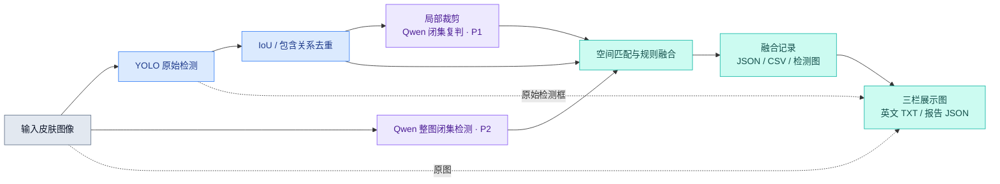

<a id="top"></a>

<div align="center">


# 儿童皮肤病图像分析 · YOLO × Qwen

**单图病灶检测 · 闭集视觉复核 · 可追溯融合 · 提示词披露**

<p>
  
  
  
  
  
</p>

<p>
  <a href="sn-article.pdf"><strong>📄 论文全文</strong></a> ·
  <a href="#quickstart">🚀 快速开始</a> ·
  <a href="#results">📊 实验结果</a> ·
  <a href="#prompts">📝 提示词披露</a> ·
  <a href="#acknowledgements">🤝 致谢与链接</a>
</p>

**An Interpretable Vision-Language Framework Integrating Visual and Morphological Features for TCM-Assisted Assessment of Pediatric Allergic Skin Diseases**

Ting Li · Shuang Song · Jian Zheng · Wei Chen

<sub>Fujian University of Traditional Chinese Medicine · Minjiang University</sub>

</div>

---

<a id="overview"></a>

## 🔎 项目概览

本目录提供上述论文相关的**单图推理、结果展示与提示词披露材料**。程序先使用 YOLO 定位候选病灶，再由 Qwen 分别检查整图与局部裁剪区域，通过空间匹配和规则融合生成检测记录，并导出「原图 / YOLO 检测图 / 英文辅助结果」三栏报告。

| 🎯 病灶检测 | 🔍 双层视觉复核 | 📋 结果追溯 |
| :--- | :--- | :--- |
| YOLO 初始定位与类别预测 | 整图上下文与局部裁剪复判 | 原始、去重与融合记录分别保存 |
| IoU 与包含关系二次去重 | 在 `data.yaml` 指定类别内判断 | JPG、TXT、JSON、CSV 多格式导出 |
| 保留候选框与原始置信度 | 记录视觉描述、图像质量与不确定性 | 保存融合动作、原因与 API 缓存 |

> [!NOTE]
> **代码覆盖范围：** 当前目录包含推理与披露工具；论文描述的检测网络训练、热图形态特征提取和完整评估流程需要额外代码与实验材料。数据集、模型权重及自定义 Ultralytics 源码需另行准备。下文的论文指标引用自随附 PDF。

<a id="workflow"></a>

## 🧩 当前代码流程



融合时，Qwen 整图框满足 **IoU ≥ 0.30** 或 **YOLO 框被其覆盖的面积比例 ≥ 0.70**，即可形成空间匹配；类别与分数随后按复判结果和支持阈值处理。最终框坐标来自去重后的 YOLO 候选框，Qwen 整图框用于提供支持，不会单独追加为最终检测框。

当前实现对每个框强制执行 `final_score ≥ yolo_confidence`，并记录 `score_before_yolo_floor`、`score_floor_applied`、`fuse_action` 与 `fuse_reason`。图像级 Top-3 通过按类别累计融合分数后归一化得到，应按算法评分理解。

<a id="results"></a>

## 📊 论文实验结果

以下数值整理自 [`sn-article.pdf`](sn-article.pdf) **Table 3（第 14 页）**，采用论文中的小数表示。它们是论文报告值，当前补充目录未提供完整训练、评估入口及重现实验所需资源。

| 方法 | Precision ↑ | Recall ↑ | mAP@0.5 ↑ | mAP@0.5:0.95 ↑ |
| :--- | ---: | ---: | ---: | ---: |
| RT-DETR | 0.376 | 0.401 | 0.320 | 0.172 |
| YOLOv8s | 0.472 | 0.410 | 0.427 | 0.212 |
| YOLO11s | 0.504 | **0.486** | 0.457 | 0.253 |
| YOLO12s | 0.473 | 0.427 | 0.420 | 0.230 |
| YOLO26s | 0.535 | 0.411 | 0.415 | 0.216 |
| **Our Method（论文）** | **0.585** | 0.455 | **0.552** | **0.500** |

相较 YOLO12s，论文方法的 Precision 和 mAP@0.5 分别提高 **11.2** 与 **13.2 个百分点**。更多子集实验、消融分析与医生评估见论文 Tables 4–6。

<a id="dataset"></a>

## 🗂️ 数据集与类别

论文使用 **CPD-10** 儿童皮肤病图像数据集。按随附论文 §3.1 的设置，共 **1,453 张图像、10 个类别**，划分为 **1,163 张训练图像**与 **290 张测试图像**。

**获取数据：** [CPD-10 数据集目录](https://github.com/ACMISLab/fdd_2020/tree/main/CPD-10) · [数据集对应论文 DKFD](https://doi.org/10.3390/app13105958)

<details>
<summary><strong>展开查看历史类别映射与图像数量</strong></summary>

类别 ID 与英文名称来自 [`original_prompt_templates_zh.json`](original_prompt_templates_zh.json)，数量来自随附论文 Table 1。

| ID | 历史类别名称 | 图像数 |
| ---: | :--- | ---: |
| 0 | Hand-Food-And-Mouth Disease | 164 |
| 1 | Atopic dermatitis | 343 |
| 2 | folliculitis | 159 |
| 3 | Chickenpox | 171 |
| 4 | Urticaria | 138 |
| 5 | insect bite | 104 |
| 6 | pyogenic paronychia | 112 |
| 7 | Impetigo | 117 |
| 8 | Diaper dermatitis | 36 |
| 9 | furuncle | 109 |
| | **合计** | **1,453** |

`Hand-Food-And-Mouth Disease` 保留历史记录中的原始拼写。实际推理从 `data.yaml` 的 `names` 读取类别；类别 ID、顺序和名称应与所用权重保持一致。上述数量描述数据集分布，不构成可恢复历史划分的图像清单。

</details>

<a id="quickstart"></a>

## 🚀 快速开始

在本目录执行命令；将 `/path/to/...` 替换为实际路径。两个 Python 文件需放在同一目录。

### 1. 准备环境

论文实验使用 Python 3.10。以下为基础安装示例；本目录未提供依赖版本锁定文件。

```bash
python3.10 -m venv .venv
source .venv/bin/activate
python -m pip install --upgrade pip

# 离线生成三栏报告所需的直接依赖
python -m pip install opencv-python pillow

# 新推理还需这些依赖，以及与权重匹配的 Ultralytics 实现
python -m pip install numpy pyyaml pandas openai torch torchvision
```

使用与训练时一致的 PyTorch/CUDA 和自定义检测网络环境。若已有包含 `ultralytics/` 包的完整源码目录，可按该项目的安装说明配置，并在推理时使用 `--yolo-root` 指定路径。自定义权重所需模块可能不包含在标准 `ultralytics` 安装包中。

### 2. 运行单图检测与融合

准备输入图像、YOLO 权重、含 `names` 字段的数据集 YAML，以及可调用对应模型的 DashScope API key：

```bash
python single_image_three_panel_report.py \
  --image /path/to/image.jpg \
  --weights /path/to/best.pt \
  --data /path/to/data.yaml \
  --yolo-root /path/to/ultralytics-skin \
  --out ./runs/image_demo \
  --api-key-stdin
```

终端提示后输入 API key，交互输入不会回显。也可提前设置 `DASHSCOPE_API_KEY` 环境变量，并省略 `--api-key-stdin`。若正确的 Ultralytics 实现已安装到当前环境，可省略 `--yolo-root`；程序也会从脚本的上级目录自动查找本地实现。

代码默认模型为 `qwen3.6-plus`，请求地址为 `https://dashscope.aliyuncs.com/compatible-mode/v1`；可通过 `--qwen-model` 和 `--base-url` 调整。在线推理会向该服务发送整图和候选区域裁剪图。

### 3. 从已有结果离线生成报告

已有融合报告时，只需图像、报告文件及 OpenCV/Pillow 环境：

```bash
python single_image_three_panel_report.py \
  --image /path/to/image.jpg \
  --report-json /path/to/reports/05_fused_final_report.json \
  --out ./runs/rendered_report
```

此模式无需模型权重、API key 或 GPU。报告必须含 `image`、`image_width`、`image_height`、`yolo_raw` 和 `fused_yolo_boxes`；程序会检查图像文件名与尺寸是否匹配。

> [!TIP]
> 每张图片使用独立的 `--out` 目录。底层推理程序的部分报告和可视化文件使用固定名称，复用目录会覆盖已有结果；调整提示词或类别设置后，也应使用新的输出目录以避免复用旧缓存。

<details>
<summary><strong>展开查看主要参数与默认值</strong></summary>

以下默认值对应推荐入口 `single_image_three_panel_report.py`。

| 参数 | 默认值 | 作用 |
| :--- | :--- | :--- |
| `--imgsz` | `640` | YOLO 推理输入尺寸 |
| `--conf` | `0.25` | YOLO 检测置信度阈值 |
| `--iou` | `0.70` | 传入 YOLO 推理的 IoU 阈值 |
| `--qwen-model` | `qwen3.6-plus` | 视觉复核模型标识 |
| `--timeout` | `120` | 单次 API 请求超时，单位为秒 |
| `--sleep` | `0.2` | API 调用间隔，单位为秒 |
| `--max-qwen-boxes` | `10` | 最多进行局部复判的 YOLO 框数 |
| `--max-qwen-full-dets` | `10` | 提示整图复核最多返回的候选框数 |
| `--crop-margin` | `0.18` | 局部裁剪的边缘扩展比例 |
| `--dedup-iou-thr` | `0.55` | 二次去重的 IoU 阈值 |
| `--dedup-contain-thr` | `0.85` | 去重时的小框覆盖比例阈值 |
| `--dedup-area-ratio-thr` | `0.65` | 去重时的小框与大框面积比例阈值 |
| `--match-iou-thr` | `0.30` | YOLO 与 Qwen 整图框的匹配阈值 |
| `--full-contain-thr` | `0.70` | YOLO 框被 Qwen 框覆盖的比例阈值 |
| `--qwen-change-thr` | `0.75` | 局部复判修改类别的概率阈值 |
| `--qwen-full-support-thr` | `0.50` | 整图类别支持的概率阈值 |

`--no-yolo-dedup` 可关闭二次去重；`--dedup-class-agnostic` 可开启跨类别去重；`--no-prefer-large-contained` 可关闭大框替换被包含小框的策略；`--no-json-mode` 可关闭 API 请求的 JSON 格式参数。

```bash
python single_image_three_panel_report.py --help
```

</details>

<a id="outputs"></a>

## 🖼️ 输出与报告

三栏展示图尺寸为 **1920 × 760**，布局如下：

| 左栏 · Original Image | 中栏 · YOLO Prediction | 右栏 · English Auxiliary Result |
| :---: | :---: | :---: |
| 原始输入图像 | YOLO 原始检测框、类别及置信度 | 基于融合记录生成的英文辅助结果 |

英文部分包含视觉优先级、汇总结果、Top-3 类别、检测证据、图像质量与限制说明。图中空间有限，完整内容同时写入 TXT 与 JSON。

一次在线推理并生成三栏报告后，主要输出为：

```text
runs/image_demo/
├── image_one_row_report.jpg            # 三栏展示图；image 为输入文件名主干
├── image_english_assessment.txt        # 完整英文辅助结果
├── qwen_cache.json                     # Qwen 请求结果缓存
├── crops/                              # YOLO 候选区域裁剪图
├── reports/
│   ├── 01_yolo_raw.json / .csv
│   ├── 02_yolo_filtered.json / .csv
│   ├── 02_yolo_removed_duplicates.csv
│   ├── 03_qwen_full_image_detection.json / .csv
│   ├── 04_qwen_crop_recheck.json / .csv
│   ├── 05_fused_final_report.json
│   ├── 05_fused_final_boxes.csv
│   └── image_three_panel_report.json   # 融合报告 + 完整英文结果
└── visualizations/
    ├── 01_yolo_raw.jpg
    ├── 02_yolo_filtered.jpg
    ├── 03_qwen_full_image_detection.jpg
    ├── 05_fused_yolo_qwen_result.jpg
    └── 06_compare_yolo_qwen_fused.jpg   # 原始 / 去重 / Qwen / 融合对比
```

离线渲染只生成三栏 JPG、英文 TXT 与扩展报告 JSON。英文文本由 `english_assessment()` 按记录组织；其中的视觉优先级来自分数和候选框数量规则，不代表临床严重程度，也不构成经验证的中医辨证结果。

<a id="prompts"></a>

## 📝 提示词与知识来源披露

本目录保留原始中文提示词、动态字段说明及请求设置，便于核对实验输入。英文概述用于说明，实际执行的提示词语言为中文。

| 标识 | 任务 | 输入与坐标 | 当前目录提供的内容 |
| :--- | :--- | :--- | :--- |
| **P1** | 局部闭集复判 | 裁剪图、YOLO 类别与置信度、类别列表 | 可执行代码与原始模板 |
| **P2** | 整图闭集检测 | 完整图像、尺寸与类别列表；原图像素 `xyxy` | 可执行代码与原始模板 |
| **P3** | 纯 VLM 自由检测 | 完整图像；`[0, 1000]` 归一化 `xyxy` | 历史提示词与设置披露，未附独立运行程序 |

- [中文原始提示词 · TXT](original_prompt_templates_zh.txt)：便于阅读和逐项核对。
- [模板与来源记录 · JSON](original_prompt_templates_zh.json)：包含动态变量、历史类别映射、来源路径及哈希。
- [Table S1 · 提示词与调用设置](table_s1_prompt_disclosure.csv)：比较三种任务的输入、输出约束和生成参数。
- [Table S2 · 知识来源说明](table_s2_knowledge_provenance.csv)：说明类别词表、任务指令、预训练知识与外部材料的来源边界。

按当前代码与 Table S2，推理请求未注入外部中医教材、指南、检索语料或证候规则，也未传入论文中的形态特征向量。提示词模板可结合变量重建请求内容，但不等同于每次历史 API 调用的独立原始存档。

<a id="files"></a>

## 📁 文件索引

| 文件 | 用途 |
| :--- | :--- |
| [`single_image_three_panel_report.py`](single_image_three_panel_report.py) | 推荐入口：运行推理或离线生成三栏报告 |
| [`single_image_yolo_qwen_compare_dedup_conf_floor_contain.py`](single_image_yolo_qwen_compare_dedup_conf_floor_contain.py) | YOLO 检测、去重、Qwen 复核、空间匹配与融合 |
| [`program_usage.txt`](program_usage.txt) | 原始命令行使用说明 |
| [`original_prompt_templates_zh.txt`](original_prompt_templates_zh.txt) | 中文提示词的可读版本 |
| [`original_prompt_templates_zh.json`](original_prompt_templates_zh.json) | 提示词、动态字段与来源记录 |
| [`table_s1_prompt_disclosure.csv`](table_s1_prompt_disclosure.csv) | 提示词与调用设置对照表 |
| [`table_s2_knowledge_provenance.csv`](table_s2_knowledge_provenance.csv) | 知识来源披露表 |
| [`sn-article.pdf`](sn-article.pdf) | 论文全文 |
| [`assets/readme-banner.svg`](assets/readme-banner.svg) | README 展示横幅 |

<a id="faq"></a>

## 💡 常见问题

<details>
<summary><strong>加载权重时提示找不到自定义模块怎么办？</strong></summary>

确认正在使用训练该权重时的检测网络实现，并通过 `--yolo-root` 指向包含 `ultralytics/__init__.py` 的完整源码目录。仅安装标准 Ultralytics 包，可能无法加载包含自定义层的权重。

</details>

<details>
<summary><strong>Qwen 请求失败后，为什么仍可能生成结果？</strong></summary>

底层程序会记录调用错误，并在相应路径保留 YOLO 结果。检查 `03_qwen_full_image_detection.json` 与 `04_qwen_crop_recheck.json` 中的 `qwen_error`，以及最终报告中的 `fuse_action`。输出文件存在并不代表所有 Qwen 请求成功。

</details>

<details>
<summary><strong>三栏图的中间一栏是融合结果吗？</strong></summary>

中间一栏显示 YOLO 原始检测结果；右侧英文文本根据融合记录生成。融合检测图单独保存在 `visualizations/05_fused_yolo_qwen_result.jpg`。

</details>

<a id="acknowledgements"></a>

## 🤝 致谢与相关链接

感谢数据集作者、检测框架维护者及相关研究团队公开数据、代码与论文，为本研究提供基础。

| 资源 | 相关贡献 | 数据 / 代码 | 对应论文 / 文档 |
| :--- | :--- | :--- | :--- |
| **CPD-10 / DKFD** | 儿童皮肤病图像数据集及原始检测研究 | [CPD-10 数据集](https://github.com/ACMISLab/fdd_2020/tree/main/CPD-10) · [DKFD 仓库](https://github.com/ACMISLab/fdd_2020) | [DKFD 论文 · Applied Sciences, 2023](https://doi.org/10.3390/app13105958) |
| **Ultralytics YOLO** | 当前脚本使用的 YOLO Python 接口与检测工具生态 | [ultralytics/ultralytics](https://github.com/ultralytics/ultralytics) | [Ultralytics 官方文档](https://docs.ultralytics.com/) |
| **YOLOv12** | 随附论文采用的 YOLO12s 检测基线 | [sunsmarterjie/yolov12](https://github.com/sunsmarterjie/yolov12) | [YOLOv12 论文 · NeurIPS 2025](https://papers.nips.cc/paper_files/paper/2025/hash/7103444259031cc58051f8c9a4868533-Abstract-Conference.html) |

CPD-10 对应文献为：Fan, D.; Li, H.; Chen, M.; Liang, Q.; Xu, H. **DKFD: Optimizing Common Pediatric Dermatoses Detection with Novel Loss Function and Post-Processing.** *Applied Sciences*, 2023, 13(10), 5958. [DOI: 10.3390/app13105958](https://doi.org/10.3390/app13105958)。使用该数据集时，请同时引用其原始工作。

本研究的论文全文见 [`sn-article.pdf`](sn-article.pdf)。作者、方法和结果以该文件为依据。

---

<div align="center">

**用于图像算法研究与辅助分析，不作为医学诊断或治疗依据。**

[返回顶部 ↑](#top)

</div>
